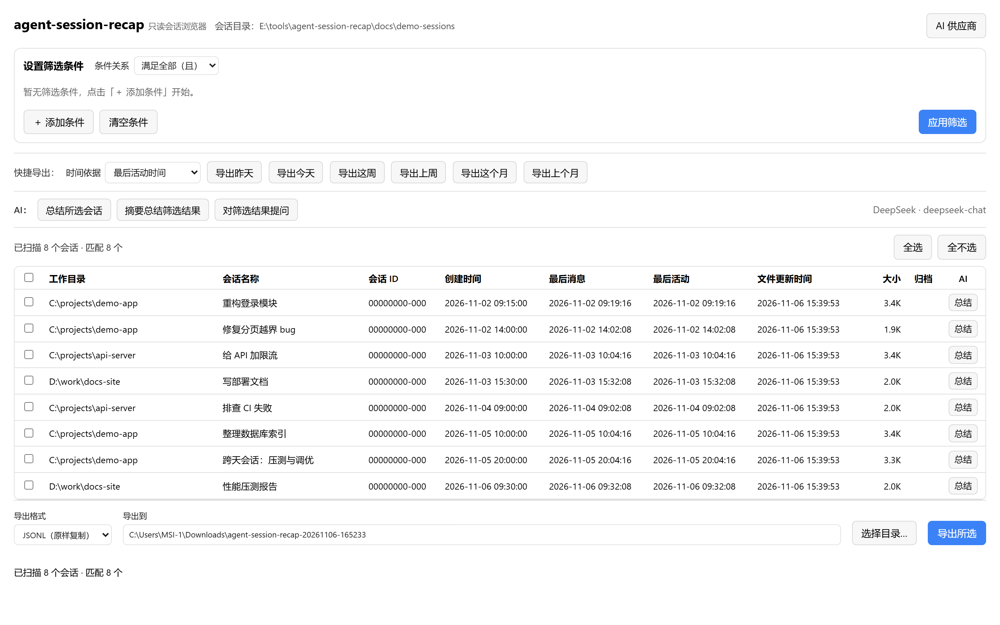
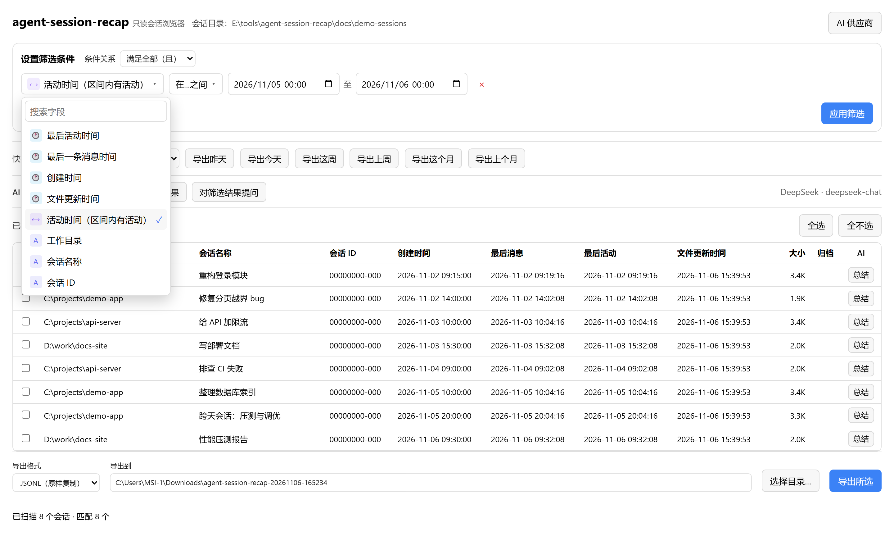
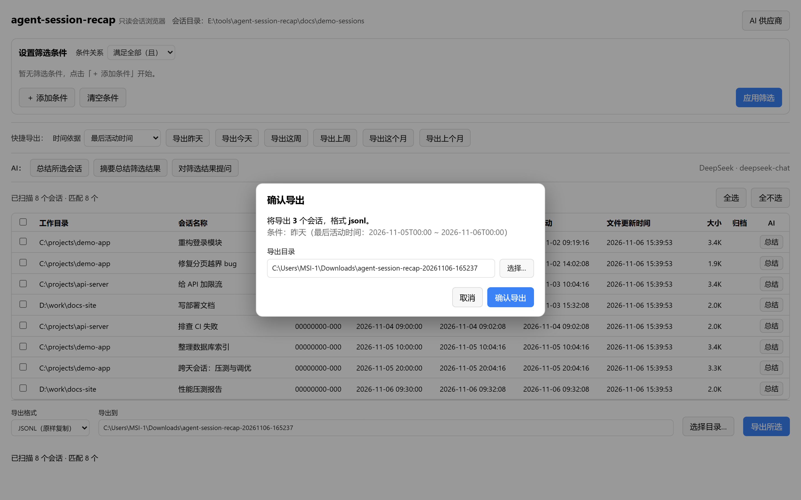

# agent-session-recap

一个用于浏览、按时间段筛选、导出 AI 编码 agent 会话，并用 AI 总结/追问这些会话的 **只读** 工具。
当前支持 [pi](https://pi.dev) 的会话，后续将扩展支持更多 agent。

它扫描 agent 使用的会话目录，可按选定的时间字段、在 `起始 → 结束` 时间区间内筛选会话，
记录筛选结果，并把选中的会话导出为 JSONL、Markdown 或 HTML。**源会话永不被修改**——导出只是复制出去。

还内置三项 AI 能力（自带供应商，配置方式与 [magpie](https://github.com/yetone/magpie) 一致）：

1. **总结某条对话** —— 会话表格里每行的「总结」按钮；
2. **对筛选出的会话做摘要总结** —— 「摘要总结筛选结果」，先逐条摘要再汇总成一份工作报告；
3. **针对筛选出的会话 AI 对话提问** —— 「对筛选结果提问」，按关键词检索相关会话后带着上下文回答。

零依赖、无构建步骤，需要 Node.js 18+。

## 截图

> 截图均使用**合成数据**（由 `scripts/make-demo.mjs` 生成），不含任何真实会话、路径或用户名。

**总览：浏览、飞书式筛选、表头排序、列宽拖拽、快捷导出**



**飞书式筛选条件构建器：字段可搜索、带类型图标、支持「且 / 或」**



**一键导出：确认弹框 + 本机原生目录选择**



## 快速开始

```bash
# 列出全部会话
node bin/agent-session-recap.mjs list

# 按「最后活动时间」筛选本地时间段
node bin/agent-session-recap.mjs list --field lastActivity --from 2026-11-05 --to 2026-11-06

# 启动网页界面（http://127.0.0.1:8651）
node bin/agent-session-recap.mjs web
```

## AI 功能

三项能力都在网页界面里，使用前先在右上角 **「AI 供应商」** 里添加一个供应商。

### 供应商管理（设计参照 magpie）

- **添加供应商**：点「＋ 添加供应商」，从预设卡片里选一个（Anthropic、OpenAI、Google Gemini、DeepSeek、Kimi、
  智谱 GLM、MiniMax、Qwen、OpenRouter、SiliconFlow、Ollama… 以及合作伙伴卡片），或选「自定义供应商」
  自己填任意兼容的 URL。
- **接口类型**：`OpenAI 兼容` / `OpenAI Responses` / `Anthropic 兼容` / `Gemini 兼容` / `System One`，
  一个供应商可以同时勾选多种，本工具会用最先可用的那种调用。
- **检测协议**：探测某个 Base URL 到底支持哪些协议，并显示每个协议的结果。
- **API 密钥**：点「显示」可查看；保存在 `~/.config/agent-session-recap/providers.json`（权限 600），
  **从不读取 shell 环境变量里的密钥**。
- **图标**：可用内置图标 ID（自动生成彩色字母徽标），也可以「选择图片…」上传一张小图。
- **模型**：「获取模型」会向供应商要模型列表，点选要用的；也可以直接手填模型 ID。
- **高级**：自定义请求头、上下文上限。
- 列表里可以逐个开关（`off`）、编辑、删除；被关掉的供应商不会出现在 AI 模型选择器里。

预设目录（69 个：40 厂商 + 18 中转 + 4 本机 + 1 远程 + 6 合作伙伴）由脚本从 magpie 源码生成，
提交在 `src/presets.json`，运行时不需要 magpie：

```bash
# 需要一份 magpie 源码 checkout（https://github.com/yetone/magpie）
node scripts/gen-presets.mjs /path/to/magpie
```

### 三项 AI 能力

| 能力 | 入口 | 说明 |
|---|---|---|
| 总结某条对话 | 表格每行的「总结」 | 读取该会话的完整轮次，生成结构化总结（背景/工作/决策/问题/结果/待办）。 |
| 摘要总结筛选结果 | 「摘要总结筛选结果」 | 先对筛选出（或勾选）的每条会话生成要点，再汇总成一份总览报告；可中途「停止」。 |
| AI 对话提问 | 「对筛选结果提问」 | 就筛选出的会话提问，自动挑出最相关的若干条作为上下文，支持多轮追问并标注参考会话。 |

三种接口都支持流式输出（SSE），可以在面板顶部切换供应商与模型。

## 会话目录来源

工具解析会话根目录的方式与 pi 完全一致，优先级从高到低：

1. `--session-dir <目录>`
2. 环境变量 `PI_CODING_AGENT_SESSION_DIR`
3. `<agentDir>/settings.json` 里的 `sessionDir`
4. `<agentDir>/sessions`（默认），其中 `<agentDir>` 为 `PI_CODING_AGENT_DIR` 或 `~/.pi/agent`

扫描范围为根目录 + 一层子目录：即各个 `--cwd--` 分组目录，以及 PiDeck 的 `.pideck-archive`。

## 时间字段

每个会话暴露四个可选时间字段（表格中全部展示），另有一个「活动时间」用于区间命中：

| 字段 | 含义 |
|---|---|
| `created` | 会话创建时间（文件头 timestamp） |
| `lastActivity` | **任意类型最后一条记录**的时间（默认） |
| `lastMessage` | **最后一条消息**的时间 |
| `mtime` | 文件系统**最后修改**时间 |
| `activity` | 会话在 `[from, to)` 内**是否有任意一条记录**（区间重叠判定，用于跨天会话） |

会话记录里的时间戳以 UTC 存储；你传入的时间区间按**本地时区**解释。区间为**半开区间** `[from, to)`。
只给日期时按本地 0 点处理，因此 `--from 2026-11-05 --to 2026-11-06` 正好选中 11 月 5 日这一整天。

## 命令

### `list`

```bash
node bin/agent-session-recap.mjs list [筛选] [--json|--csv] [--save <文件>] [--limit <n>]
```

输出表格（或 JSON/CSV）。`--save <文件>` 会把筛选结果写入 JSON，供 `export --result` 使用。

### `web`

```bash
node bin/agent-session-recap.mjs web [--port 8651] [--host 127.0.0.1] [--open]
```

提供一个轻量单页界面 + 少量 JSON 接口，默认只绑定 `127.0.0.1`。页面里可以设置筛选、勾选行、
选择导出格式与输出目录（预填「下载」下带时间戳的子文件夹），然后导出；也可以用 AI 总结与提问。

- **飞书式筛选器**：点「＋ 添加条件」，每条条件为 `字段 ▾ 条件 ▾ 值`，字段下拉带搜索与类型图标；
  条件之间可选「满足全部（且）」或「满足任一（或）」。支持字段：活动时间（区间内有活动）/ 最后活动时间 /
  最后一条消息时间 / 创建时间 / 文件更新时间 / 工作目录 / 会话名称 / 会话 ID / 大小 / 归档。筛选在浏览器本地完成。
  「活动时间（区间内有活动）」用于跨天会话：只要会话在 `[起始, 结束)` 内有**任意一条记录**即命中，
  不会因为「最后活动时间/创建时间落在区间外」而遗漏。
- **表头点击排序**：点任意列标题按该列升序/降序切换（再点一次反向）。
- **列宽可拖拽调整**：拖动表头右边缘改列宽，宽度记住在浏览器本地。
- **快捷导出**：一键导出固定时间段的全部会话——昨天、今天、这周、上周、这个月、上个月
  （可选择时间依据字段，周一为一周开始）。
- **确认弹框 + 目录选择**：一键导出（及「导出所选」）会先弹确认框，显示会话数量、格式与条件，
  并可直接「选择目录…」调用本机原生文件夹选择对话框（Windows 用 PowerShell 弹出）。

接口：`GET /api/config`、`GET /api/sessions`、`POST /api/export`、`POST /api/pick-dir`；
供应商：`GET/POST /api/providers`、`PATCH/DELETE /api/providers/<id>`、`POST /api/providers/models`、
`POST /api/providers/test`、`POST /api/prefs`；
AI（SSE）：`POST /api/ai/summarize`、`POST /api/ai/summarize-batch`、`POST /api/ai/chat`。

### `export`

```bash
node bin/agent-session-recap.mjs export [筛选 | --result <文件>] [--ids a,b] \
    --format jsonl|md|html --out <目录>
```

- `jsonl` —— 原样复制会话文件。
- `md` —— 每轮输出 **用户** 与 **助手** 文本、**工具名称**，以及 token/耗时（不含思考过程，不含工具参数与结果）。
- `html` —— 与 Markdown 相同内容，生成独立带样式的网页。

`--out` 默认为「下载」目录下按时间戳新建的子文件夹，例如 `Downloads\agent-session-recap-20261106-142530`，
避免导出文件散落在下载目录里。每次导出都会生成一份 `manifest.json` 清单。同名文件不会覆盖（自动追加数字后缀）。

## 筛选参数

| 参数 | 说明 |
|---|---|
| `--field <名称>` | `created` \| `lastActivity` \| `lastMessage` \| `mtime` \| `activity`（区间内有活动）（默认 `lastActivity`） |
| `--from <时间>` | 起始时间（含），本地时区 |
| `--to <时间>` | 结束时间（不含），本地时区 |
| `--include-archived` | 同时包含 `.pideck-archive` 归档会话 |
| `--cwd <通配符>` | 匹配工作目录，例：`"*\\项目\\*"` |
| `--grep <关键词>` | 匹配 名称 / 预览 / 工作目录 / 会话 ID |

## 目录结构

```
agent-session-recap/
├─ bin/agent-session-recap.mjs   CLI 入口
├─ src/
│  ├─ paths.mjs          sessions 根目录解析（对齐 pi 优先级）
│  ├─ scanner.mjs        收集 *.jsonl（根 + 一层子目录）
│  ├─ parser.mjs         流式元数据 + 完整轮次解析
│  ├─ filter.mjs         字段 × [from,to) 过滤
│  ├─ report.mjs         表格 / JSON / CSV 输出
│  ├─ export.mjs         JSONL 复制 / Markdown / HTML
│  ├─ providers.mjs      AI 供应商存储与管理（magpie 兼容 schema）
│  ├─ presets.json       供应商预设目录（由 scripts/gen-presets.mjs 生成）
│  ├─ ai.mjs             AI 客户端（OpenAI / Responses / Anthropic / Gemini）+ 总结/摘要/提问
│  ├─ server.mjs         轻量 http + JSON 接口 + SSE
│  └─ cli.mjs            参数解析与命令分发
├─ public/               网页界面（index.html、app.js、ai.js、style.css）
└─ scripts/              gen-presets.mjs（生成预设）、make-demo.mjs、shoot.mjs
```

## 说明

- 只读保证：唯一的写操作是导出目录、`--save` 文件、网页服务的内存缓存，以及 `~/.config/agent-session-recap/providers.json`（AI 供应商配置）。源会话文件只会被读取。
- AI 请求由本机直接发给你选择的供应商；本工具不经过任何中转服务。
- 损坏或未写完的行会被跳过；以最后一条有效记录为准。

## 许可证

[MIT](LICENSE) © 2026 gugugaga008
